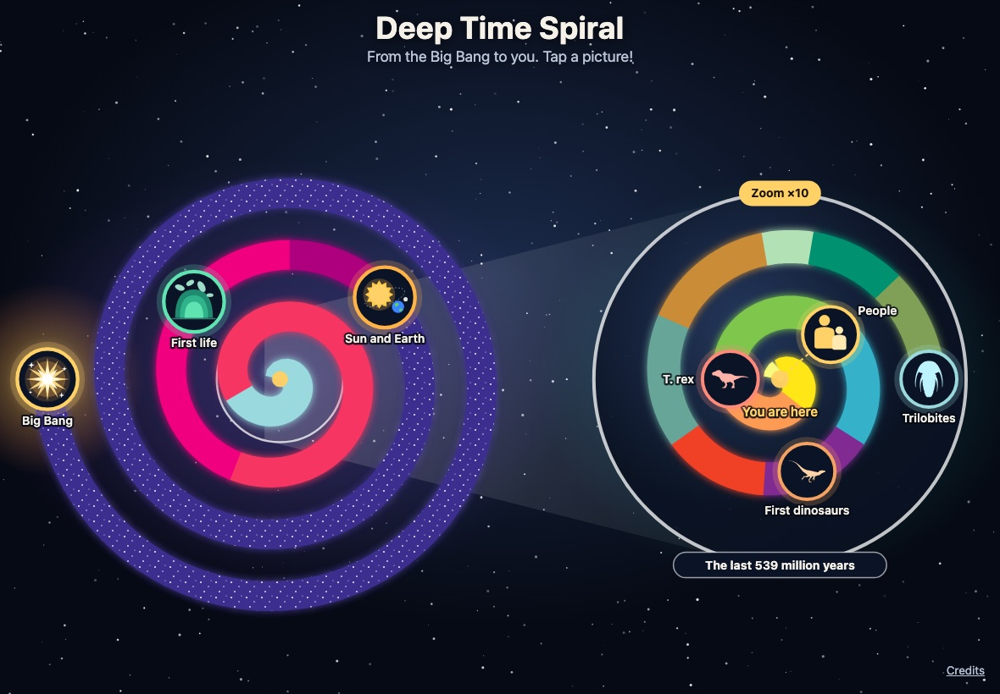

# Deep Time Spiral

An interactive geologic time spiral that helps children aged 5–8 *feel* how old things are: from their own age, to a grandparent's life, to the dinosaurs, to the formation of Earth, to the Big Bang.

Inspired by the USGS *Geologic Time Spiral* (GIP 58, 2008), with ages updated to the current
[ICS International Chronostratigraphic Chart](https://stratigraphy.org/chart) and a cosmic prologue.

> **Status:** live at https://benoitguillaud.github.io/deep-time-spiral/ with the ICS data (M1) and the illustrated
> 2D spiral. Next (M2): the spiral becomes an interactive **3D vortex** you can spin and zoom. See the milestones in
> [CLAUDE.md](CLAUDE.md).



## Run it locally

Requires Node 26 (see [`.nvmrc`](.nvmrc)).

```bash
npm install
npm run dev            # live-reload dev server at http://localhost:5173
npm run dev -- --host  # also reachable from a tablet on the same Wi-Fi (use the "Network" URL it prints)
```

The page draws the corkscrew as a still 2D picture first, then hands over to the same corkscrew in 3D (three.js) if the
browser has WebGL. Spin with one finger, pinch to zoom, slide with two fingers (or right-drag, Shift+drag, the arrow keys,
or the **Move** button), and tap a picture to fly to it. Without a graphics chip (WebGL drawn in software, about
2 frames per second) the page stays in 2D. Add `?view=2d` to the address to stay in 2D, or `?view=3d` to force 3D.

Every visit opens on a **start screen**: pick a language, then **Start** begins a slow **journey** (about a minute)
from Now back to the Big Bang, with captions beside the spiral, **read aloud slowly** by the browser's own voice
(`speechSynthesis`, 0.8× speed; the spark waits at each stop until the voice has finished). **Skip** (or Escape) jumps
to the end and the **Journey** button replays it. Tapping a picture reads its card aloud; the **Voice** button turns
the voice off. Where the device has no voice for the language, the text still shows and the speaker greys out.
`?journey=0` opens straight on the spiral, `?journey=fast` plays the journey 12× faster (both for tests).

**Languages:** English, French, German and Hungarian (`?lang=en|fr|de|hu`, otherwise the last choice, then the
browser's language). The French, German and Hungarian texts are **first drafts by Claude, not yet reviewed by native
speakers**: corrections are welcome in `src/i18n/*.json`.

```bash
npm run build && npm run preview
```

## Checks

```bash
npm run check                          # typecheck, lint, format check, unit tests (Vitest)
npx playwright install chromium webkit # once, before the first e2e run
npm run test:e2e                       # Playwright: Chromium + WebKit, tablet + phone
npm run format                         # fix formatting
npm run data:ics                       # regenerate src/data/ics-units.json from data/ics/chart.ttl
```

Every pull request runs the same checks in GitHub Actions, plus Lighthouse on mobile (accessibility ≥ 95,
performance ≥ 90). Merging to `main` deploys to GitHub Pages.

## Project documents

- [CLAUDE.md](CLAUDE.md): mission, pedagogy, data rules, architecture, quality gates and milestones.
- [CREDITS.md](CREDITS.md): data sources, citations, reuse terms and illustration licences.
- [docs/DEPLOY.md](docs/DEPLOY.md): deployment checklist (GitHub Pages, Vercel, custom domain).

## Licence

_To be decided._ Data and illustrations keep their own licences; see [CREDITS.md](CREDITS.md).
